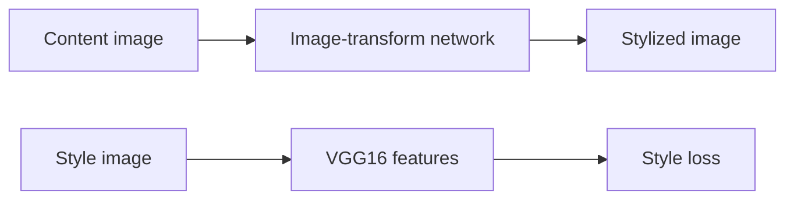
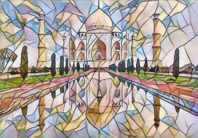

# Fast Neural Style Transfer

### Exploring artistic stylization with residual image-transform networks.

**PyTorch · VGG16 perceptual loss · Residual CNN**

*Archived coursework / research prototype · Not actively maintained*

A recovered style-transfer implementation and coursework showcase. It combines content reconstruction, Gram-matrix style matching, and optional total-variation regularization to train a feed-forward stylization network.

*Original archived content image.*

## What is included

- Residual convolutional image-transform network
- VGG16 content/style feature extraction
- Single-image and batch stylization scripts
- Archived example outputs across multiple styles

The repository includes 3 directly browsable source/notebook files and a [source archive](source.zip) containing 9 files with their package structure preserved. See [SOURCE_INDEX.md](SOURCE_INDEX.md) for its contents. Reference components retain their labels and upstream notices.

## Workflow

*Diagram reconstructed from the recovered source or project description.*

## Preserved results and examples

*Archived Mosaic-style example.*

*Archived Candy-style example.*

*Archived Starry Night-style example.*

These are historical artifacts, not fresh executions. Where a report includes scores or rankings, their original evaluation protocol has not been independently reproduced.

## Explore / run

Extract `source.zip` and inspect `environment.yml`, `training_script.py`, and `stylization_script.py`. The archived environment pins Python 3.8.3 and PyTorch 1.5.0. Compatible weights are not bundled; inference needs a matching checkpoint. Downloader links are retained as historical configuration and were not tested.

### Direct source files

- [training_script.py](training_script.py)
- [stylization_script.py](stylization_script.py)
- [environment.yml](environment.yml)

## Project status

The example images are preserved artifacts from the recovered source collection, not outputs generated during this upload. Their inclusion does not establish a newly reproduced training run.

No training, benchmark, paid API request, or external service deployment was performed to prepare this showcase. Team names, student IDs, raw personal documents, and embedded credentials are excluded from the public upload copies. Additional scope notes are in [SOURCE_NOTES.md](SOURCE_NOTES.md).
